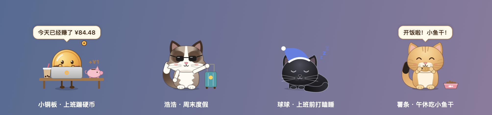
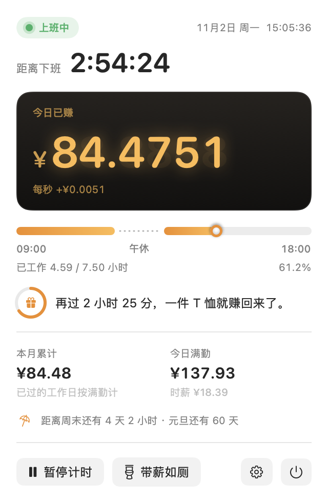
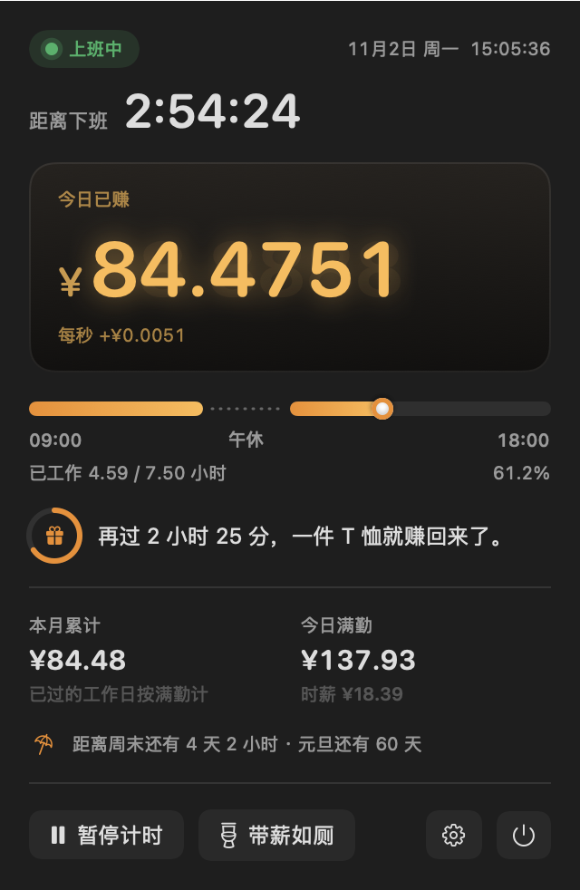
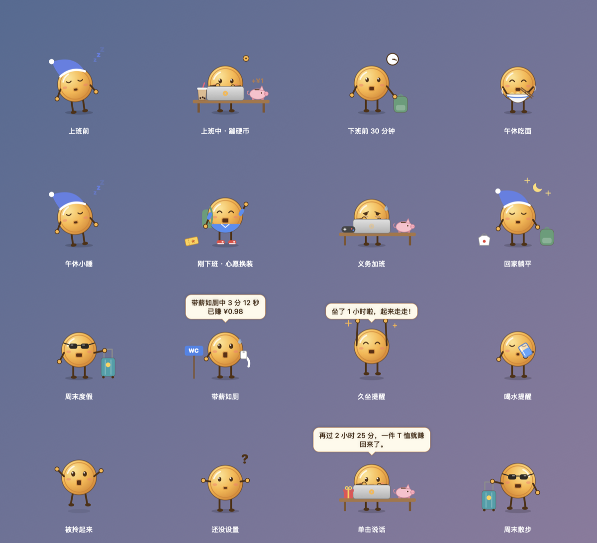
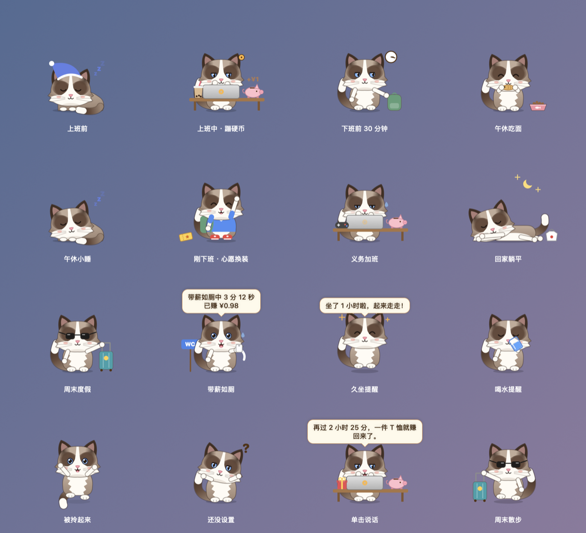
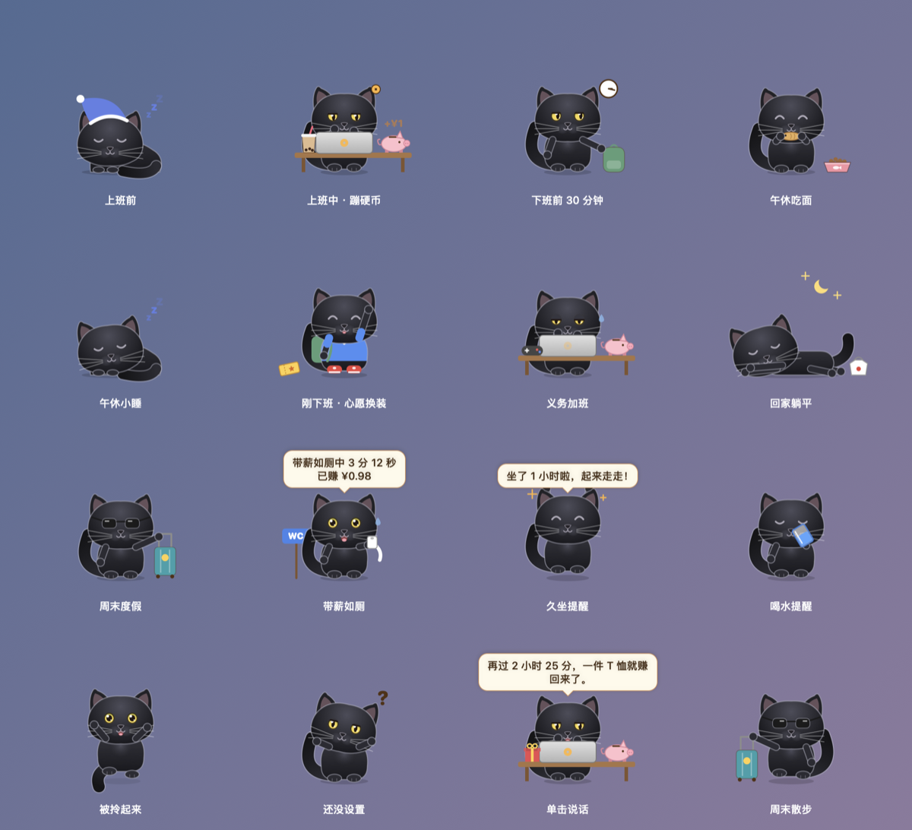
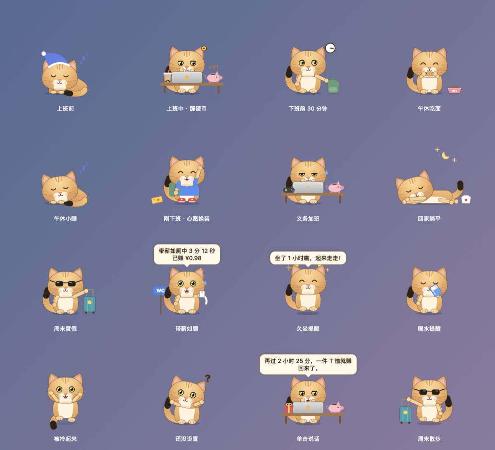

# 牛马搭子（NiumaBuddy）· Mac 版

常驻菜单栏的「工资计价器」：今日已赚金额实时跳动，点开能看到下班倒计时、当日时间轴和心愿进度。



<p align="center">
  
  
</p>

<p align="center"><sub>截图里的金额按月薪 3000 演示</sub></p>

## 功能

- **菜单栏金额**：今日已赚常驻菜单栏（可在设置里改成只显示图标）
- **计价屏**：今日已赚保留 4 位小数，每 0.25 秒跳一次，下方显示每秒赚多少
- **状态与倒计时**：还没上班 / 上班中 / 午休中 / 已下班 / 休息日，分别倒数到上班、下班、下午开工
- **当日时间轴**：长度按真实时间比例画，午休是断开的虚线，圆点标出现在的位置
- **心愿清单**：「再过 2 小时 25 分，一件 T 恤就赚回来了」，清单可以自己编辑
- **本月累计**：已过的工作日按满勤补算，再加上今天已赚
- **暂停计时**：把金额定格在此刻，再点一次恢复
- **法定节假日**：自动按国务院放假安排调整，放假日不上班、调休补班的周末照常计薪（可关闭）
- **桌面小铜板**：一枚会走路的方孔铜钱（方孔就是嘴），住在屏幕右下角，动作跟着上班状态变：上班前戴睡帽打瞌睡、上班敲键盘（每赚一笔蹦一枚硬币进存钱罐）、午休吃面再小睡、下班前收拾包看表、下班挥手、加班冒汗、周末戴墨镜拖行李箱溜达。单击聊两句，双击弹出面板，按住拖动，右键有更多
- **换形象**：设置里可以把小铜板换成三只照着真猫画的猫：「浩浩」是布偶猫（深棕面罩、白色倒 V 脸、蓝眼睛、白手套、尾巴带白尖），「球球」是黑猫（圆脸小耳朵、金黄眼睛，身上一圈浅色轮廓，深色桌面上也看得清），「薯条」是金渐层（金黄色身子、额头几道淡条纹、奶白下巴和胸口、圆圆的绿眼睛、尾巴尖是黑的）。动作和小铜板一样，另外上班前和午休会揣着手团成一团，回家侧躺摊平，台词也带点猫味；位置和统计不受影响
- **心愿换装**：今天赚回了 T 恤就穿上 T 恤、赚回跑鞋就换上红鞋，奶茶、外卖、电影票、游戏机摆在旁边
- **带薪如厕**：面板或右键点一下开始，回来再点，算出这趟赚了多少（午休时间不算带薪）
- **义务加班**：下班后键鼠还在动就计时，显示白送老板多少钱
- **假期倒计时**：「距离周末还有 3 天 2 小时 · 元旦还有 58 天」，没公布的年份按节日当天估
- **健康提醒**：久坐提醒（连续坐满 60 分钟）、喝水提醒（上班时每 60 分钟）、下班提醒，都弹系统通知，桌宠也会伸懒腰、举杯喝水；通知里不写金额
- **设置**：月薪、日薪折算方式（法定 21.75 天 / 本月实际工作日）、上下班和午休时间、工作日、登录时自动启动

### 桌宠的全部动作

每个形象都有 16 种状态，点开看：

<details>
<summary>小铜板</summary>



</details>

<details>
<summary>浩浩（布偶猫）</summary>



</details>

<details>
<summary>球球（黑猫）</summary>



</details>

<details>
<summary>薯条（金渐层）</summary>



</details>

截图都由 App 自己生成：`.build/debug/NiumaBuddy --snapshot <目录>`，改了界面重新跑一遍再替换 `docs/images/` 里的图即可。

### 节假日数据

数据来自 [holiday-cn](https://github.com/NateScarlet/holiday-cn)（MIT），整理自国务院办公厅每年的放假通知：

- 已公布的年份内置在 App 里（`Sources/NiumaBuddy/BuiltinHolidays.swift`），断网也能用
- App 启动时和之后每 12 小时联网检查今年和明年的安排，缓存在 `~/Library/Application Support/NiumaBuddy/holidays/`
- 下载的数据会严格校验（年份、日期格式、条数、名称长度），不合法就整份丢弃，继续用已有数据
- 想把新一年的数据也内置进去：`python3 -I scripts/update_holidays.py 2026 2027`，再重新打包

## 编译与安装

只需要 Command Line Tools（`xcode-select --install`），不需要 Xcode。

```bash
./scripts/build.sh
```

产物在 `build/牛马搭子.app`（Apple 芯片 + Intel 通用），拖进「应用程序」文件夹，双击打开后到菜单栏右上角找 `¥`。

## 分享给别人

```bash
./scripts/package.sh
```

在 `dist/` 下生成两个文件，发哪个都行：

- `牛马搭子-1.0.dmg`：双击打开后把 App 拖进「应用程序」，里面附带《首次打开说明.txt》，推荐发这个
- `牛马搭子-1.0.zip`：解压就是 App

对方需要 macOS 14 或更新。App 没有经过 Apple 公证，**对方第一次打开时要手动放行一次**：

- macOS 15 及更新：双击被拦 → 点「完成」→「系统设置 → 隐私与安全性」→ 最下面点「仍要打开」→ 输密码
- macOS 14：按住 Control 点按 App →「打开」→「打开」
- 或者在终端执行 `xattr -dr com.apple.quarantine /Applications/牛马搭子.app`

不想让对方做这一步，就得加入 Apple Developer Program（个人 99 美元/年），用 Developer ID 证书签名并公证：

```bash
codesign --force --options runtime --timestamp --sign "Developer ID Application: 你的名字 (TEAMID)" "build/牛马搭子.app"
# 打包出 dmg 后提交公证（凭据先用 notarytool store-credentials 存进钥匙串，不要写在脚本里）
xcrun notarytool submit "dist/牛马搭子-1.0.dmg" --keychain-profile <钥匙串配置名> --wait
xcrun stapler staple "dist/牛马搭子-1.0.dmg"
```

## 开发用命令

```bash
swift build && .build/debug/NiumaBuddy --selftest      # 计算逻辑自检
.build/debug/NiumaBuddy --snapshot /tmp/niumabuddy-snap  # 把面板在几个典型时刻渲染成 PNG
```

### 桌宠的耗电

桌宠每一帧用 `ImageRenderer` 画成图片直接贴到图层上，气泡和点击区域是盖在上面、很少刷新的一层 SwiftUI。
不要改回 `TimelineView` 直接驱动 SwiftUI 窗口：那样每帧都要走一遍 SwiftUI 刷新界面的流程，每秒 6 帧就要约 4% CPU，现在约 1.5%。
帧率分三档（`PetMotion`）：平时每秒 6 帧，蹦跳/拖动/散步/说话时 20 帧，人离开电脑 2 分钟以上降到 2 帧，窗口被挡住或关掉桌宠时完全停下。两只猫的画法在 `PetArtCat.swift`（毛色、长相在 `CatCoat` 里，姿势共用），和小铜板共用桌子、行李箱这些道具。

## 许可

本项目用 [MIT 协议](LICENSE)。内置的节假日数据来自 holiday-cn（MIT），版权声明见 [THIRD_PARTY_NOTICES.md](THIRD_PARTY_NOTICES.md)，打包时会一起放进 App 和 DMG。

## 已知限制

- 只认全国统一的放假安排，地方性假日（如广西「三月三」）和公司自己的调休不会自动识别
- 「按法定 21.75 天」折算时，放假的日子不计入本月累计；想让月底累计正好等于月薪，用「按本月实际工作日」
- 不支持跨零点的夜班（下班时间必须晚于上班时间）
- 本地 ad-hoc 签名、未公证，别人第一次打开需要手动放行（见「分享给别人」）
